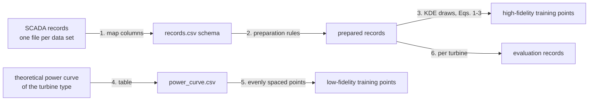

# Data pipeline

How the two inputs of the method are built, what format the framework expects, and which checks it applies. The repository contains no measured data; `mfgpr_framework.synthetic` generates an invented example.

## Sources

| Input | What it is | In the paper's case study |
|---|---|---|
| Measured records (high fidelity) | Operating data of a wind farm at 10-minute (or similar) resolution: per turbine and interval, the nacelle wind speed and the active power | The public Spatial Dynamic Wind Power Forecasting (SDWPF) data set of the KDD Cup 2022: a wind farm of 134 turbines of 1.5 MW, 245 days at 10-minute resolution, with turbine locations (Zhou et al., 2022, arXiv:2208.04360) |
| Theoretical power curve (low fidelity) | Power as a function of wind speed for the turbine type, from the manufacturer's data sheet or a reference collection | The theoretical curve of a 1.5 MW turbine type (reference [26] of the paper); cut-in, rated and cut-out wind speeds 3, 14 and 25 m/s |

Before using a data set, check its licence and the terms of the release you download, and cite it as its authors ask.

## Steps

1. **Map the columns** of the data set to the records schema below. For the SDWPF layout (`TurbID`, `Day`, `Tmstamp`, `Wspd`, `Patv`), `mfgpr_framework.from_sdwpf(df)` does this: `turbine_id = TurbID`, `wind_speed = Wspd`, `power = Patv`, and `time` = (Day − 1) days + Tmstamp.
2. **Prepare the records** (`prepare_records`):
   - remove rows whose wind speed or power is missing or not finite;
   - remove rows with negative active power (by default; `drop_negative_power=False` keeps them);
   - nothing else is filtered. Scatter, stops and curtailment stay in the data, because the KDE draws are meant to represent the full operating behaviour (Section 2 of the paper). The function returns the number of rows removed by each rule.
3. **Draw the high-fidelity training points** from the kernel density estimate of all prepared records of the farm (`kde_sample`; Eqs. 1–3). The paper's case study uses 200 draws.
4. **Tabulate the theoretical curve** as `power_curve.csv` (schema below), in kW and m/s, including the zero-power ranges below cut-in and above cut-out.
5. **Take the low-fidelity training points** from the curve: `low_fidelity_points(curve, n)` returns `n` evenly spaced wind speeds over the range of the table with linearly interpolated power. The paper's case study uses 200 points.
6. **Evaluation records:** the prepared records of each evaluated turbine (`run_experiment`; see [experiments.md](experiments.md)).

## Data checks before a run

- **Units:** power in kW (some data sets use MW or W); wind speed in m/s.
- **Same turbine type:** the theoretical curve must belong to the turbine type of the records; rated power and cut-out speed of the records should match it.
- **Wind speed:** nacelle anemometer readings are affected by the rotor; mixing nacelle and met-mast speeds in one data set changes the scatter.
- **Duplicates and time stamps:** one row per turbine and interval; check for repeated intervals after merges.
- **Stuck values:** long runs of identical wind speed or power usually come from sensor or communication faults. The preparation rules keep them (as the method uses the full scatter); decide case by case whether a data set needs an extra rule.
- **Share removed:** `prepare_records` reports how many rows each rule removed; a large share points to a unit or column-mapping problem.

## Input files

An input directory holds two CSV files (`read_inputs`, `write_inputs`). Each file is checked when read; a violation raises `DataError` with the file and the column.

### `records.csv`

| Column | Type | Unit | Rule |
|---|---|---|---|
| `turbine_id` | integer or text | – | required, not empty |
| `time` | text or timestamp | – | optional; used only for plotting time series |
| `wind_speed` | number | m/s | required; missing or non-finite rows are removed by `prepare_records` |
| `power` | number | kW | required; missing, non-finite and (by default) negative rows are removed by `prepare_records` |

### `power_curve.csv`

| Column | Type | Unit | Rule |
|---|---|---|---|
| `wind_speed` | number | m/s | finite, strictly increasing, at least two rows |
| `power` | number | kW | finite, ≥ 0 |

## Output tables

See [architecture.md](architecture.md#output-tables).
