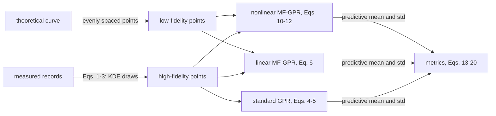

# Method

This document states the method of the paper, section by section, with the paper's equation numbers (1)–(20), and shows where each part lives in the code.

- Paper: H. Li, C. Feng, J. Zhang, "A Multi-Fidelity Gaussian Process Regression Method for Probabilistic Wind Farm Power Curve Estimation", *Proceedings of ASME IDETC/CIE 2023*, Volume 3A, V03AT03A034, [doi:10.1115/DETC2023-114762](https://doi.org/10.1115/DETC2023-114762).
- [Conventions of this implementation](#conventions-of-this-implementation) lists the definitions that the framework makes explicit.

## Overview

The goal is a probabilistic power curve: for a wind speed $x$, a predictive distribution of the power $y$, not only a point estimate. The method combines two sources of information:

| Fidelity | Source | Character |
|---|---|---|
| low (level 0) | theoretical power curve of the turbine type | smooth, complete over all wind speeds, but does not show how a turbine actually operates |
| high (level 1) | measured operating records (wind speed, active power) | real behaviour, including scatter, stops and curtailment, but noisy and very numerous |

Three steps lead from data to curve:

1. **Kernel density sampling (Section 2.1).** A kernel density estimate of the measured records is built, and a few hundred points are drawn from it. They keep the shape of the full scatter without any cleaning.
2. **Gaussian process models (Sections 2.2–2.3).** A multi-fidelity Gaussian process links the theoretical curve (low fidelity) to the sampled records (high fidelity).
3. **Evaluation (Sections 3.2–3.3).** Deterministic metrics for the mean curve, and probabilistic metrics for the predictive distribution.

The case study compares three models: a nonlinear multi-fidelity GP (Eqs. 10–12), a linear multi-fidelity GP (Eq. 6), and a standard GP trained on the high-fidelity data alone (Eqs. 4–5).

## 2.1 Kernel density estimation, Eqs. (1)–(3)

For records $x_1,\dots,x_n$, the density is estimated by

$$\hat f_h(x) = \frac{1}{nh}\sum_{i=1}^{n} K_h\!\left(\frac{x-x_i}{h}\right) \tag{1}$$

with the Gaussian kernel and the standard normal density

$$K_h(x) = \frac{1}{h}\,\phi\!\left(\frac{x}{h}\right) \tag{2}$$

$$\phi(x) = \frac{e^{-x^2/2}}{\sqrt{2\pi}} \tag{3}$$

The bandwidth $h$ controls the smoothness of the estimate.

**In the framework** (`kde.py`):

- The records are pairs $z = (\text{wind speed}, \text{power})$. Eqs. (1)–(2) are applied in product form with one bandwidth per coordinate:
  $\hat f_h(z) = \frac{1}{n}\sum_i \prod_k \frac{1}{h_k}\phi\!\left(\frac{z_k - z_{ik}}{h_k}\right)$ (`kde_density`).
- Drawing from $\hat f_h$: choose a record uniformly at random and add Gaussian noise with standard deviation $h_k$ to coordinate $k$ (`kde_sample`). The draws follow the density of the data, so dense regions of the scatter are represented in proportion and sparse outliers rarely.
- Default bandwidth: Scott's rule per coordinate, $h_k = \sigma_k\, n^{-1/(d+4)}$ (`scott_bandwidth`). Any scalar or per-coordinate value can be given.
- Optional limits reject draws outside physical ranges, for example negative speed or power (`lower`, `upper`).

## 2.2 Gaussian process regression, Eqs. (4)–(5)

A Gaussian process prior with zero mean and covariance function $c(x,x';\theta)$ is placed on the unknown function $f$. Observations are $y_i = f(x_i) + \varepsilon_i$ with Gaussian noise of variance $\sigma_n^2$. With $C_{ij} = c(x_i,x_j;\theta)$ for the training inputs and $c_*$ the covariances between a new input $x$ and the training inputs, the posterior mean and variance are

$$\hat f(x) = c_*^{\top}\left(C+\sigma_n^2 I\right)^{-1} y \tag{4}$$

$$\operatorname{Var}[\hat f(x)] = c(x,x) - c_*^{\top}\left(C+\sigma_n^2 I\right)^{-1} c_* \tag{5}$$

**In the framework** (`gp.py`, `GaussianProcess`):

- The hyperparameters (kernel parameters and $\sigma_n^2$) are estimated by maximising the log marginal likelihood
  $\log p(y\mid X,\theta) = -\tfrac12 y^{\top}(C+\sigma_n^2 I)^{-1}y - \tfrac12\log\lvert C+\sigma_n^2 I\rvert - \tfrac n2\log 2\pi$,
  with exact gradients, L-BFGS-B, and several random restarts (see the conventions).
- `predict(X)` returns Eqs. (4)–(5). `predict(X, include_noise=True)` adds $\sigma_n^2$, which gives the predictive distribution of a new measurement instead of the latent curve.

## 2.3 Multi-fidelity GP models, Eqs. (6)–(12)

### Linear (autoregressive) fusion, Eq. (6)

Levels $t = 0,\dots,T-1$ are ordered from the lowest to the highest fidelity. Each level is the scaled previous level plus an independent GP:

$$g_t(x) = \rho\, g_{t-1}(x) + \delta_t(x) \tag{6}$$

$\rho$ measures the correlation between the levels, and $\delta_t \sim \mathcal{GP}(\mu_{\delta_t}, c_t)$.

**In the framework** (`multifidelity.py`, `LinearMultiFidelityGP`):

- One scaling factor per pair of consecutive levels, $\rho_0,\dots,\rho_{T-2}$; $g_0 = \delta_0$; all $\delta_t$ have zero mean.
- All levels form one joint GP. With $a_{t,j} = \prod_{i=j}^{t-1}\rho_i$ (empty product = 1), the covariance between level $t$ at $x$ and level $s$ at $x'$ is
  $\operatorname{cov}\big(g_t(x), g_s(x')\big) = \sum_{j \le \min(t,s)} a_{t,j}\,a_{s,j}\,c_j(x,x')$
  (`LinearMultiFidelityKernel`). For two levels this is $c_0$, $\rho c_0$ and $\rho^2 c_0 + c_1$.
- The kernels $c_j$, the factors $\rho$ and one noise variance per level are estimated together by maximising the joint marginal likelihood. The prediction at the highest level follows from Eqs. (4)–(5) applied to the joint covariance.

### Weighted combination of low-fidelity models, Eqs. (7)–(9)

Section 2.3 also reviews the family of surrogates that combine $M$ low-fidelity models $f_1,\dots,f_M$ with a high-fidelity model $f_{M+1}$ in a weighted sum with an adjustment term:

$$\hat f(x) = \sum_{m=1}^{M} w_m(x) f_m(x) + \epsilon(x) \tag{7}$$

$$w_m(x) = \frac{\omega_m(x)}{\sum_{i=1}^{M}\omega_i(x)} \tag{8}$$

$$\omega_m(x) = \frac{\lVert f_m(x) - f_{M+1}(x)\rVert^2}{\sigma^2_{f_{M+1}}} \tag{9}$$

The case study compares the models of Eq. (6) and Eqs. (10)–(11); the framework implements those two.

### Nonlinear (recursive) fusion, Eqs. (10)–(12)

When the levels are not linearly related, the GP prior of the previous level in Eq. (6) is replaced by its posterior $f_{*t-1}$, and level $t$ becomes a GP over the joint input $(x, f_{*t-1}(x))$:

$$f_t(x) = g_t\big(x, f_{*t-1}(x)\big) \tag{10}$$

with $g_t \sim \mathcal{GP}\big(0, c_t((x, f_{*t-1}(x)), (x', f_{*t-1}(x'));\theta_t)\big)$. The covariance is structured to reflect the autoregressive form:

$$c_t^{g} = c_t^{\rho}(x,x';\theta_t^{\rho})\cdot c_t^{f}\big(f_{*t-1}(x), f_{*t-1}(x');\theta_t^{f}\big) + c_t^{\delta}(x,x';\theta_t^{\delta}) \tag{11}$$

All kernels are squared-exponential (radial basis function) kernels with automatic relevance determination:

$$c_t(x,x';\theta_t) = \sigma_t^2 \exp\!\left(-\frac12\sum_{i=1}^{d} w_{i,t}\,(x_i - x_i')^2\right) \tag{12}$$

**In the framework** (`multifidelity.py`, `NonlinearMultiFidelityGP`; `kernels.py`):

- Level 0 is a GP on $x$ with an RBF kernel.
- Level $t \ge 1$ is a GP on the inputs $[x, \bar f_{t-1}(x)]$, where $\bar f_{t-1}$ is the posterior mean of level $t-1$ at the training inputs of level $t$. Its kernel is `RBF(x) * RBF(f) + RBF(x)`, which is Eq. (11).
- The variance of $c_t^{f}$ is fixed to 1, because only the product of the variances of $c_t^{\rho}$ and $c_t^{f}$ can be identified.
- `RBF` is parameterised by length scales $l_i$; the weights of Eq. (12) are $w_{i,t} = l_i^{-2}$.
- **Prediction** propagates the uncertainty of level $t-1$ by Monte Carlo sampling. $S$ samples of $f_{t-1}(x)$ are drawn, level $t$ is evaluated at $[x, \text{sample}]$ for each, and the results are combined by the law of total variance:
  mean $= \frac1S\sum_s m_s$, variance $= \frac1S\sum_s v_s + \operatorname{Var}_s(m_s)$.
  The standard-normal numbers used for sampling are drawn once when the model is fitted, so predictions are deterministic afterwards (`n_samples`, default 100).

## 3.2 Deterministic metrics, Eqs. (13)–(17)

For predictions $\hat x_i$ and actual values $x_i$, $i = 1,\dots,n$ (`metrics.py`):

$$\mathrm{RMSE} = \sqrt{\frac{\sum_{i=1}^{n}(\hat x_i - x_i)^2}{n}} \tag{13}$$

$$\mathrm{NRMSE} = \frac{1}{x_{\max}}\sqrt{\frac{\sum_{i=1}^{n}(\hat x_i - x_i)^2}{n}} \tag{14}$$

$$\mathrm{MAE} = \frac1n\sum_{i=1}^{n}\lvert\hat x_i - x_i\rvert \tag{15}$$

$$\mathrm{NMAE} = \frac1n\sum_{i=1}^{n}\frac{\lvert\hat x_i - x_i\rvert}{x_{\max}} \tag{16}$$

$$\mathrm{MAPE} = \frac{100\%}{n}\sum_{i=1}^{n}\left\lvert\frac{\hat x_i - x_i}{x_i}\right\rvert \tag{17}$$

## 3.3 Probabilistic metrics, Eqs. (18)–(20)

**Pinball loss** for the quantile $\tau$ (`pinball_loss`, `mean_pinball_loss`):

$$L_\tau(y,\hat y) = \begin{cases}(y-\hat y)\,\tau, & y \ge \hat y\\ (\hat y - y)(1-\tau), & y < \hat y\end{cases} \tag{18}$$

**Sharpness** for $N$ forecast samples with $M$ forecast probabilities each, where $\bar p_j$ is the average probability of category $j$ (`sharpness`):

$$S = \frac1N\sum_{i=1}^{N}\sum_{j=1}^{M}(\hat p_{ij} - \bar p_j)^2 \tag{19}$$

**Reliability** for observations $Y_i$ and forecast CDFs $\hat F_i$ (`reliability_gaussian`, `reliability_numeric`):

$$Re = \frac1N\sum_{i=1}^{N}\int_{-\infty}^{\infty}\big[\hat F_i(z) - \mathbb{I}(Y_i \le z)\big]^2\,dP(z) \tag{20}$$

**Interval diagnostics** (`interval_width`, `interval_coverage`, `interval_curves`): for a list of nominal proportions $\alpha$, the mean width of the central $\alpha$ prediction intervals and the share of observations inside them. These are the curves over nominal proportions used to compare the models' probabilistic estimates.

## Conventions of this implementation

- **Units:** wind speed in m/s, power in kW. NRMSE and NMAE are dimensionless (fractions of $x_{\max}$).
- **Output scaling:** before fitting, all outputs are divided by one common scale $s$ (default: the standard deviation of all training outputs pooled); predictions are multiplied back (`ModelOptions.output_scale`). The prior mean stays zero, as in Eq. (4). Inputs are not scaled.
- **Starting values and limits of the hyperparameters** (`multifidelity.default_rbf`):
  - start: kernel variance = variance of the outputs; length scale = 20 % of the input range; noise variance = 1 % of the output variance;
  - each length scale stays between the median spacing of the distinct training inputs and 100 times their range. The lower limit keeps the optimiser away from the degenerate optimum in which the kernel turns into white noise;
  - log-variances stay within $[-12, 12]$ and noise variances within $[10^{-8}, 10^{4}]$ (in scaled units).
- **Optimisation:** L-BFGS-B with exact gradients from the current values, plus `restarts` starts perturbed by standard-normal noise on the log scale; the best optimum is kept. `seed` makes restarts and Monte Carlo numbers repeatable.
- **Predictions:** `PowerCurveModel.predict` returns the mean and the standard deviation in kW. By default the noise variance of the highest level is included (distribution of a measured value); `include_noise=False` gives the latent curve, Eq. (5).
- **$x_{\max}$ in Eqs. (14) and (16):** a value given by the user; the experiment default is the maximum of the theoretical curve (the rated power).
- **Eq. (17):** records with $\lvert x_i\rvert \le$ `min_actual` are left out (default 0, which leaves out only $x_i = 0$, where the relative error is undefined).
- **Eq. (18):** the predictive quantile is $\hat y_\tau = \mu + \sigma\,\Phi^{-1}(\tau)$ of the Gaussian predictive distribution; the loss is averaged over records and over a grid of $\tau$ (default 0.05, 0.10, …, 0.95).
- **Eq. (19):** the $M$ categories are equal power bins between 0 and $x_{\max}$ (default $M = 10$); the two outer bins also take the tails. $\hat p_{ij}$ is the predictive probability of bin $j$ for record $i$.
- **Eq. (20):** $dP(z) = dz$. For a Gaussian forecast the integral has the closed form $\sigma\left[u\,(2\Phi(u)-1) + 2\phi(u) - 1/\sqrt{\pi}\right]$, $u = (y-\mu)/\sigma$; `reliability_numeric` integrates any forecast CDF on a grid.
- **Number of levels:** the paper uses two levels. Both multi-fidelity classes accept any number of levels, ordered from the lowest fidelity to the highest.
